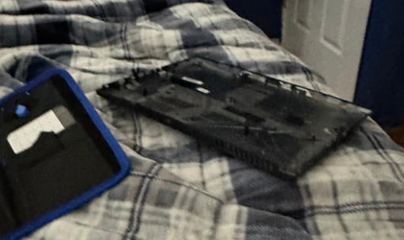
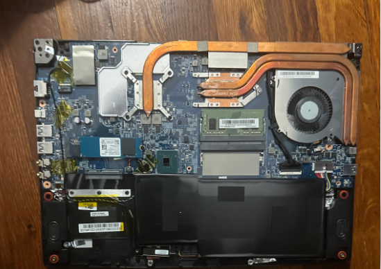
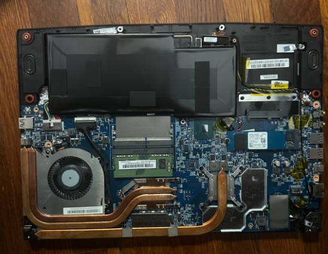
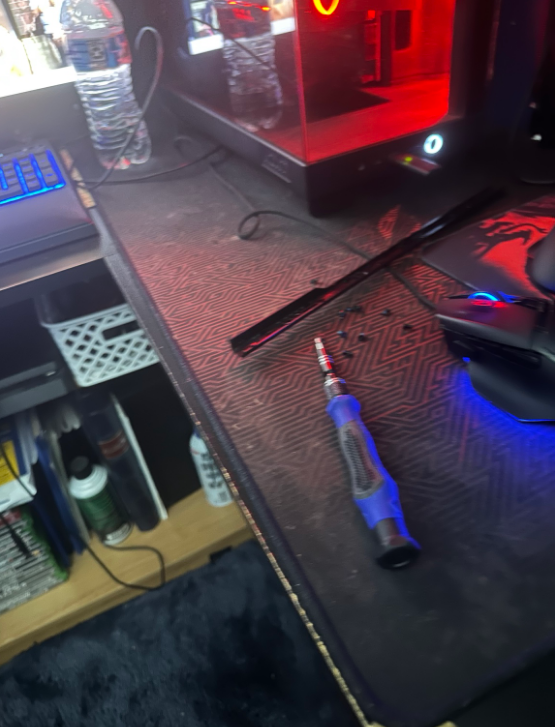
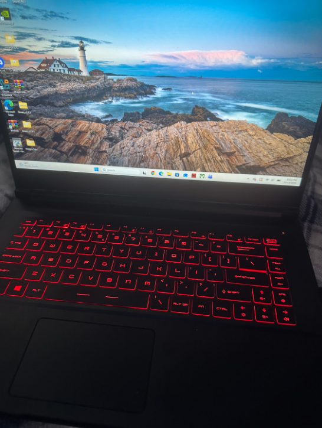

# Laptop Hardware Maintenance and SSD Upgrade

## Project Overview

This personal  hardware project documents my hands-on experience disassembling and reassembling my gaming laptop, identifying internal hardware components, and verifying that Windows 11 boots successfully afterward.

The next part of this project I will  upgrade the laptop's SSD storage because the SSD this laptop came is only 256 GB. 

## Tools Used

- Screwdriver
- Laptop running Windows 11
- Camera for hardware documentation

## Step 1: Prepare the Laptop

1. Power down the laptop.
2. Disconnect the power adapter.
3. Position the laptop upside down on a suitable work surface.
4. Locate the screws securing the bottom cover.

## Step 2: Remove the Bottom Cover

1. Remove the screws securing the bottom panel.
2. Carefully separate the bottom cover from the laptop chassis.
3. Remove the cover to expose the internal hardware.

## Step 3: Identify Internal Components

After removing the cover, I examined the laptop's internal hardware.

Components identified:

- RAM (Random Access Memory)
- M.2 SSD
- Motherboard
- Internal battery
- Cooling fan
- Copper heat pipes
- Internal storage bay

## Step 4: Reassemble the Laptop

1. Position the bottom cover back onto the laptop.
2. Align the cover with the laptop chassis.
3. Carefully secure the cover.
4. Reinstall the screws.

The laptop was reassembled without replacing any internal components during this stage.

## Step 5: Verify Successful Reassembly

After reassembling the laptop, I powered it on and successfully booted into Windows 11.

This confirmed that the laptop could start normally following the disassembly and reassembly process.

## Step 6: Planned SSD Upgrade

**Status: Not Yet Completed**

The next phase of this project will involve:

1. Identifying a compatible SSD.
2. Preparing the laptop for installation.
3. Installing the SSD.
4. Configuring the storage in Windows 11.
5. Verifying that the SSD is detected and functioning correctly.
6. Documenting the upgrade with additional photographs.

## Skills Demonstrated

- Laptop hardware disassembly and reassembly
- Computer hardware identification
- Basic hardware maintenance
- Windows 11 boot verification
- Technical documentation
- Hardware troubleshooting fundamentals

## Project Status

**Completed:** Laptop disassembly, reassembly, hardware identification, and successful Windows 11 boot verification.

**Planned:** SSD storage upgrade.
